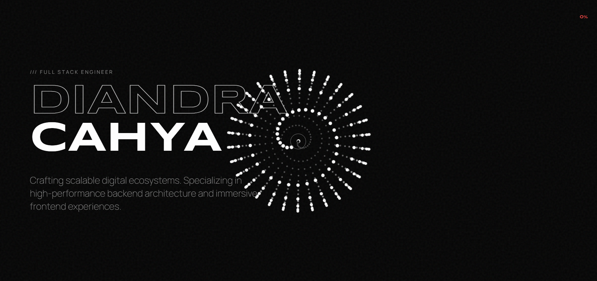

# 🚀 Interactive Portfolio Website

A modern, highly interactive portfolio website built with **HTML, CSS, and Vanilla JavaScript**. This project focuses on creating an immersive user experience through smooth animations, custom UI components, and a dynamic particle-based background.



---

## ✨ Features

- 🎨 Modern cyber-inspired UI
- 🌌 Dynamic animated particle background using HTML5 Canvas
- 📜 Smooth scrolling experience
- 🖱️ Custom animated cursor
- 📊 Custom scrollbar with live progress indicator
- 🚀 Intro loading animation
- 📱 Fully responsive design
- 🎭 Text scramble animation
- 💼 Interactive project showcase with modal preview
- 📈 Animated statistics counter
- ⚡ Lightweight with no frontend framework

---

## 🛠️ Tech Stack

- HTML5
- CSS3
- Vanilla JavaScript (ES6)
- HTML5 Canvas API
- Anime.js

---

## 📂 Project Structure

```
.
├── index.html
├── style.css
├── script.js
```

---

## 🚀 Getting Started

1. Clone this repository.
2. Open the project folder.
3. Launch `index.html` in your browser.

That's it! No installation or build process is required.

---

## 🎯 Highlights

This portfolio includes several custom-built interactions:

- Animated loading screen
- Dynamic particle morphing between sections
- Interactive project modal
- Smooth reveal animations
- Mouse tracking effects
- Animated counters
- Infinite marquee skills section
- Responsive layout optimized for desktop and mobile

---

## 📄 License

This project is available for personal inspiration and educational purposes.

---

## 👤 Author

**Diandra Cahya**

- GitHub: https://github.com/DiandraCahya
- LinkedIn: https://linkedin.com/in/diandracahyasaputra
